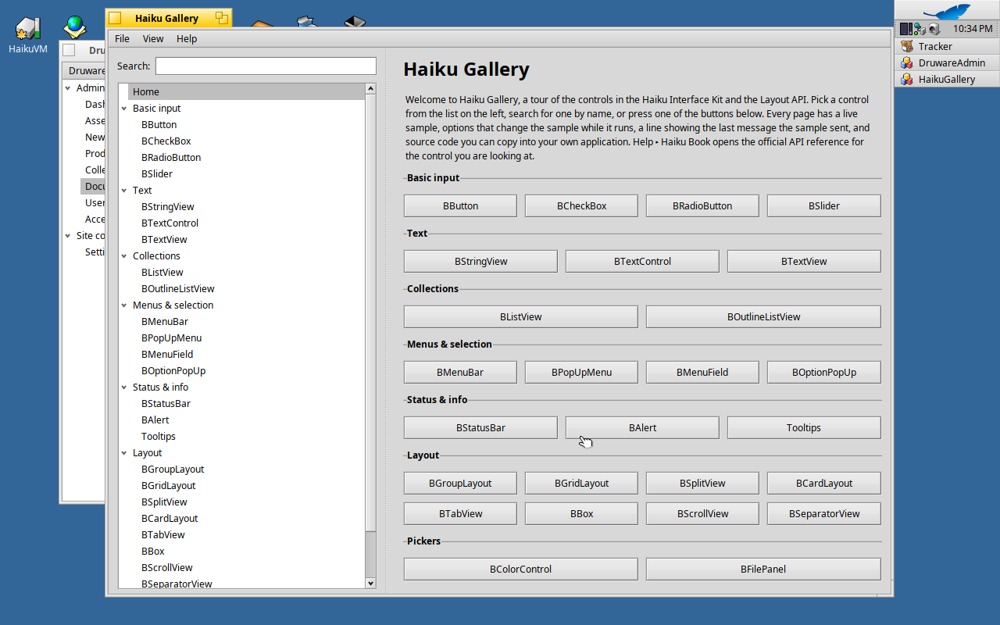

# Haiku Gallery

Haiku Gallery is a native Haiku application that shows the controls of the Haiku Interface Kit and the Layout API, in the spirit of Microsoft's WinUI 3 Gallery. Each control has a page with a description, a live sample, options that change the sample while it runs, a line showing the messages the sample sends, and a source snippet you can copy.



More screenshots: [BSlider](docs/images/slider.png), [BListView](docs/images/listview.png), [BTabView](docs/images/tabview.png), [BColorControl](docs/images/colorcontrol.png). They were taken on Haiku hrev57937 (x86_64).

## What it shows

| Category | Pages |
| --- | --- |
| Basic input | BButton, BCheckBox, BRadioButton, BSlider |
| Text | BStringView, BTextControl, BTextView |
| Collections | BListView, BOutlineListView |
| Menus & selection | BMenuBar (with BMenu and BMenuItem), BPopUpMenu, BMenuField, BOptionPopUp |
| Status & info | BStatusBar, BAlert, Tooltips (BView::SetToolTip) |
| Layout | BGroupLayout, BGridLayout, BSplitView, BCardLayout, BTabView, BBox, BScrollView, BSeparatorView |
| Pickers | BColorControl, BFilePanel |

BColumnListView is not included: its header lives in Haiku's private headers (`headers/private/interface`), and the gallery uses public API only.

The window itself is built from the same pieces: a BOutlineListView for navigation with a BTextControl to filter it, a BSplitView, and a BCardView holding one page per control.

## Building

Haiku Gallery targets Haiku R1/beta5 or newer and builds with the system GCC (C++17).

1. Install the development packages if they are not already installed:

   ```sh
   pkgman install haiku_devel makefile_engine
   ```

2. Build:

   ```sh
   cd Gallery
   make
   ```

   The executable is written to `objects.<arch>-<compiler>-release/HaikuGallery`, for example `objects.x86_64-cc13-release/HaikuGallery`. `make clean` removes the build output; `make DEBUGGER=TRUE` builds with debug information.

The build links against `libbe` and `libtracker` (for BFilePanel) and the C++ standard library; the resource file `HaikuGallery.rdef` sets the application signature `application/x-vnd.Druware-HaikuGallery`, the version and `B_SINGLE_LAUNCH`.

## Running

Run the executable from Tracker or from Terminal:

```sh
objects.*/HaikuGallery
```

Help ▸ Open documentation folder opens the `docs` folder in Tracker. It looks next to the executable first, then in the folder above it, so it finds the source tree's `docs` when you run the binary from `objects.*/`.

Help ▸ Haiku Book page for this control opens the official API reference for the current page in the web browser.

## Using the gallery

- Pick a control in the list on the left, press a button on the home page, or type in the search field to filter the list by control or category name.
- Use the options panel to change the sample; the line under the sample shows the last message it received, for example `Value changed: 42`.
- Select text in the source box and copy it, or press Copy source.
- View ▸ Show navigation (Alt+N) hides the list; View ▸ Home (Alt+H) goes back to the home page; View ▸ Find control (Alt+F) focuses the search field.

## Project layout

```
Makefile                 makefile-engine build file
HaikuGallery.rdef        application signature, version and flags
src/
  App.cpp/.h             BApplication subclass and main()
  MainWindow.cpp/.h      menu bar, navigation pane, card view, message routing
  NavigationList.cpp/.h  BOutlineListView with search filtering
  PageRegistry.cpp/.h    the list of pages: one line per control
  Messages.h             all message codes
  pages/
    GalleryPage.cpp/.h   abstract base class for a page
    HomePage.cpp/.h      welcome page
    *Page.cpp/.h         one page per control
docs/
  index.md               control documentation by category
  architecture.md        how the application is built
  controls/*.md          one page per control
  images/                screenshots
```

## Adding a control page

1. Add the message codes the page needs to `src/Messages.h`.
2. Write `src/pages/FooPage.h/.cpp`, a subclass of `GalleryPage` implementing `Title()`, `Description()`, `SourceSnippet()`, `CreateSample()`, optionally `CreateOptions()`, and `HandleMessage()` (end it with `return GalleryPage::HandleMessage(message);`).
3. Add one line to `kPages` in `src/PageRegistry.cpp`, plus its `#include`:

   ```cpp
   { "Basic input", &Create<FooPage> },
   ```

4. Add `src/pages/FooPage.cpp` to `SRCS` in the `Makefile`.
5. Document it in `docs/controls/` and `docs/index.md`.

Navigation, search, the home page and the Haiku Book link pick the page up automatically. See [docs/architecture.md](docs/architecture.md) for details on how pages receive messages.

## Documentation

- [Control documentation](docs/index.md): purpose, header and library, constructors, key methods, messages, an example and Haiku Human Interface Guidelines notes for every control.
- [Architecture](docs/architecture.md): how Haiku Gallery itself is put together.
- [The Haiku Book](https://www.haiku-os.org/docs/api/): the official API reference.
